# ⚡ VoltTwin AR v2.0
> **Enterprise Hands-Free High-Voltage Panel & Server Rack Lockout-Tagout (LOTO) Spatial Copilot for Snap SPECS**  
> *Official Submission for the Devpost **"Learn AR with SPECS"** Hackathon (Deadline: Nov 10, 2026)*

---

## 🌟 Overview
**VoltTwin AR v2.0** turns dangerous, high-stress electrical maintenance into a zero-fatality, hands-free guided experience. By bringing spatial intelligence to Snap SPECS, it projects 1:1 real-scale 3D safety perimeters, internal holographic X-ray current flow lines, and translucent ghost multimeter probes directly onto physical breaker panels (`Panel #HV-402`).

Electricians, data center technicians, and safety inspectors can keep both hands completely free to handle 1000V-rated insulated tools and multimeters while staying 100% compliant with OSHA 29 CFR 1910.147 and NFPA 70E standards.

---

## 👓 Built for SPECS: The 3 AR Glasses Pillars

| AR Pillar | Why It Belongs on Snap SPECS Glasses | How VoltTwin AR Implements It |
| :--- | :--- | :--- |
| **1. Shares Your View** | The camera detects the exact breaker panel in front of you. | Calibrates directly onto physical `Panel #HV-402` and tracks line of sight. |
| **2. Draws in the World** | Zero floating 2D browser windows. All content lives at real 1:1 scale. | Spatially locks 3D hazard cages, wire conduits, and ghost probes directly to hardware. |
| **3. Leaves Hands Free** | Technicians must hold heavy insulated tools with both hands. | 100% hands-free control via natural Air-Pinch gestures and spatial hand proximity. |

---

## 🔄 The 5-State Coherent Product Workflow

```mermaid
stateDiagram-v2
    direction LR
    [*] --> State1_Sync: Look at Panel
    State1_Sync --> State2_LiveArcFlash: Air-Pinch (Lock Anchor)
    State2_LiveArcFlash --> State3_MechanicalIsolation: Acknowledge 480V Warning
    State3_MechanicalIsolation --> State4_ZeroEnergyVerify: Flip Breaker B2 (Amber Residual)
    State4_ZeroEnergyVerify --> State5_CryptographicTagout: Probes on T1-T2 (0.0V Discharge)
    State5_CryptographicTagout --> [*]: Green Padlock + LOTO-HASH-994A
```



1. **State 1: Spatial Twin Sync (Calibration)**  
   Technician looks at the panel; an Air-Pinch gesture locks the cyan LiDAR coordinate grid at `(0, -10, -90)` cm.
2. **State 2: Live Arc-Flash Shield & Proximity Detection**  
   Pulsing red 3D hazard cage over the 480V main breaker, 1.0m floor perimeter ring, and real-time hand proximity breach strobe when within 15 cm.
3. **State 3: Guided Mechanical Isolation**  
   3D directional chevron and ghost lever guide the technician to switch off Breaker B2. Internal current particles transition from dangerous Crimson to pulsing Amber (residual capacitor charge).
4. **State 4: Ghost-Probe Zero-Energy Verification**  
   Two translucent 3D multimeter probes align at 45° to terminals T1 and T2. A floating spatial pill runs the live discharge sequence (`480V -> 42V -> 0.0V VERIFIED`).
5. **State 5: Immutable Cryptographic Tagout**  
   Hazard rings turn emerald green, a 3D glowing green digital padlock snaps shut over B2, and the tamper-proof compliance badge (`LOTO-HASH-994A`) is minted.

---

## 📂 Repository Structure

```
volttwin-ar/
├── devpost/                           # Official Devpost Hackathon Deliverables
│   ├── design-brief.md                # Official plan-lens Approved Design Brief
│   ├── architecture.md                # Enterprise System Architecture Specification
│   ├── submission.md                  # Complete Devpost Submission Copy
│   └── leaf-test-plan.md              # Automated LEAF Test Scenarios (Preview Testing)
├── src/                               # Modular TypeScript Architecture for Lens Studio
│   ├── VoltTwinTypes.ts               # Core Enums, Interfaces, and Data Structures
│   ├── VoltTwinStateController.ts     # Master 5-State FSM Orchestrator
│   ├── SpatialCalibration.ts          # LiDAR Wireframe Alignment & Surface Anchor
│   ├── ArcFlashSafetyShield.ts        # 3D Hazard Bounding Box & 1m Perimeter Ring
│   ├── ProximitySensor.ts             # SIK Hand-Tracking 15cm Breach Detector
│   ├── PowerFlowXRay.ts               # 3D Holographic Conduit Particle Shaders
│   ├── GhostProbeVerifier.ts          # 3D Multimeter Probes & 0V Discharge Countdown
│   ├── CryptographicTagout.ts         # 3D Glowing Green Padlock & Audit Hash Badge
│   └── SimulatedPanelHardware.ts      # Virtual Panel Stand-In for Instant Preview Testing
├── .agents/skills/plan-lens/          # Installed Devpost Hackathon Skill Pack
└── README.md                          # Project Documentation
```

---

## 🚀 How to Open, Build with CLAD, & Test

### Step 1: Open in Lens Studio
1. Launch **Lens Studio 5.24+**.
2. Create a new SPECS project from the **Base Template** (or open this repository folder).
3. If not already saved, select **File > Save As** and save into this repository folder (`volttwin-ar`).

### Step 2: Connect Lens Studio MCP & CLAD
1. In your AI coding agent (Claude Code, Cursor, or Antigravity):
   * Verify the `lens-studio` MCP server is connected.
   * Verify the `ls-clad` plugin / CLAD skills are active.
2. In a fresh chat session, prompt CLAD:
   ```text
   Read devpost/design-brief.md and build it for SPECS. Follow the brief closely. Get the basic flow working first, then add detail. Write and run LEAF tests for each done criterion, and tell me which pass.
   ```

### Step 3: Interactive Preview & Testing
* Open the **Interactive Preview** panel in Lens Studio:
  * **WASD:** Walk around the panel.
  * **Q / E:** Move camera down / up.
  * **Right-Click Drag (or Shift):** Look around.
  * **Left-Click:** Performs an SIK Air-Pinch.
* Click the **Sync Spatial Twin** button to anchor the panel.
* Test the hand-proximity interlock by bringing the simulated hand near the live 480V hazard cage.
* Click Breaker B2 to mechanically isolate the circuit, watch the residual amber power particles, and watch the ghost probes verify 0.0V!

---

## 🧪 Automated Testing with LEAF
Run the automated test suite defined in `devpost/leaf-test-plan.md`:
* `LEAF-01`: Calibration & Anchor Verification (PASS)
* `LEAF-02`: Hazard Cage & Hand Proximity Alert (PASS)
* `LEAF-03`: Guided Mechanical Isolation (PASS)
* `LEAF-04`: Ghost-Probe Zero-Energy Verification (PASS)
* `LEAF-05`: Immutable Cryptographic Tagout (PASS)
