# ⚡ VoltTwin AR v2.0
> **Enterprise Hands-Free High-Voltage Panel & Server Rack Lockout-Tagout (LOTO) Spatial Copilot for Snap SPECS**  
> *Official Submission for the Devpost **"Learn AR with SPECS"** Hackathon (Deadline: Nov 10, 2026)*

---

## 🌟 Overview
**VoltTwin AR v2.0** turns dangerous, high-stress electrical maintenance into a zero-fatality, hands-free guided experience. By bringing spatial intelligence to Snap SPECS, it projects 1:1 real-scale 3D safety perimeters, internal holographic X-ray current conduits with dynamic thermal heatmaps, and translucent ghost multimeter probes directly onto physical breaker panels (`Panel #HV-402`).

Electricians, data center technicians, and safety inspectors can keep both hands completely free to handle 1000V-rated insulated tools and multimeters while staying 100% compliant with OSHA 29 CFR 1910.147 and NFPA 70E standards.

---

## 👓 Built for SPECS: The 3 AR Glasses Pillars

| AR Pillar | Why It Belongs on Snap SPECS Glasses | How VoltTwin AR Implements It |
| :--- | :--- | :--- |
| **1. Shares Your View** | The camera detects the exact breaker panel in front of you. | Calibrates directly onto physical `Panel #HV-402` and tracks head-gaze dwell vector. |
| **2. Draws in the World** | Zero floating 2D browser windows. All content lives at real 1:1 scale. | Spatially locks 3D hazard cages, dynamic thermal conduits, and ghost probes directly to hardware. |
| **3. Leaves Hands Free** | Technicians must hold heavy insulated tools with both hands. | 100% hands-free control via natural Voice Commands ("Toggle B2"), Air-Pinches, and Gaze Dwell Interlocks. |

---

## 🔄 The 5-State Coherent Product Workflow

```mermaid
stateDiagram-v2
    direction LR
    [*] --> State1_Sync: Look at Panel
    State1_Sync --> State2_LiveArcFlash: Air-Pinch (Lock Anchor)
    State2_LiveArcFlash --> State3_MechanicalIsolation: "Check Status" / Acknowledge 480V
    State3_MechanicalIsolation --> State4_ZeroEnergyVerify: "Toggle B2" (Amber Residual)
    State4_ZeroEnergyVerify --> State5_CryptographicTagout: 1.5s Gaze on T1 + 0.0V Discharge
    State5_CryptographicTagout --> [*]: "Lockout Complete" (Green Padlock)
```



1. **State 1: Spatial Twin Sync (Calibration)**  
   Technician looks at the panel; an Air-Pinch gesture locks the cyan LiDAR coordinate grid at `(0, -10, -90)` cm.
2. **State 2: Live Arc-Flash Shield & Proximity Detection**  
   Pulsing red 3D hazard cage over the 480V main breaker, 1.0m floor perimeter ring, amber-hot thermal heatmap ($68^\circ\text{C}$), and real-time hand proximity breach strobe when within 15 cm.
3. **State 3: Guided Mechanical Isolation (Hands-Free Voice)**  
   Saying *"Toggle B2"* or clicking flips Breaker B2 to OFF. Internal current particles transition from dangerous Crimson to pulsing Amber (residual capacitor charge).
4. **State 4: Ghost-Probe Zero-Energy Verification & 1.5s Gaze Interlock**  
   Requires a continuous 1.5-second head-gaze lock on Terminal Pin T1 to clear the safety interlock. Ghost probes align at 45° as the thermal conduits cool down to cold blue ($21^\circ\text{C}$) and voltage discharges: `480V -> 42V -> 0.0V VERIFIED`.
5. **State 5: Immutable Cryptographic Tagout**  
   Saying *"Lockout Complete"* transitions all perimeters to emerald green, snaps a 3D glowing green digital padlock over B2, and generates the immutable audit tag (`LOTO-HASH-994A`).

---

## 📂 Repository Structure

```
volttwin-ar/
├── devpost/                           # Official Devpost Hackathon Deliverables
│   ├── design-brief.md                # Official Approved Brief (plan-lens template)
│   ├── architecture.md                # Enterprise System Architecture Specification
│   ├── submission.md                  # Complete Devpost Submission Copy
│   └── leaf-test-plan.md              # Automated LEAF Test Scenarios (Preview Testing)
├── src/                               # Modular TypeScript Architecture for Lens Studio
│   ├── VoltTwinTypes.ts               # Core Enums, Interfaces, and Data Structures
│   ├── VoltTwinStateController.ts     # Master 5-State FSM Orchestrator
│   ├── SpatialCalibration.ts          # LiDAR Wireframe Alignment & Surface Anchor
│   ├── ArcFlashSafetyShield.ts        # 3D Hazard Bounding Box & 1m Perimeter Ring
│   ├── ProximitySensor.ts             # SIK Hand-Tracking 15cm Breach Detector
│   ├── PowerFlowXRay.ts               # 3D Holographic Conduit Particle Shaders
│   ├── GhostProbeVerifier.ts          # 3D Multimeter Probes & 0V Discharge Countdown
│   ├── CryptographicTagout.ts         # 3D Glowing Green Padlock & Audit Hash Badge
│   ├── VoiceCommandDispatcher.ts      # Hands-Free Speech Engine ("Toggle B2", "Lockout Complete", "Explode View")
│   ├── ThermalHeatmapOverlay.ts       # Dynamic Joule Heating Gradient (Amber-Hot to Cold-Blue)
│   ├── GazeDwellInterlock.ts          # 1.5-Second Head-Gaze Lock Safety Interlock on T1
│   ├── SpatialObjectDetection.ts      # Optical CV Tracking Box & 99.4% Confidence Lock
│   ├── ExplodedViewController.ts      # 3D Exploded-View Architecture & Module Expansion
│   ├── RemoteSupervisorTelemetry.ts   # Live Expert Hologram & Audio Waveform HUD
│   └── SimulatedPanelHardware.ts      # Virtual Panel Stand-In for Instant Preview Testing
├── tests/                             # Automated Test Verification Framework
│   ├── leaf_runtime_mock.ts           # Lens Studio & LEAF Runtime Simulation Engine
│   └── run_leaf_tests.ts              # Executable LEAF Automated Test Suite (10 Scenarios)
├── .agents/skills/plan-lens/          # Installed Devpost Hackathon Skill Pack
├── volttwin-ar.esproj                 # Lens Studio Spectacles Project Descriptor
├── .mcp.json                          # Lens Studio MCP Server Configuration
└── README.md                          # Project Documentation
```

---

## 🧪 Automated Testing with LEAF (10 of 10 Scenarios Passing)
Run the automated test suite locally:
```bash
npx tsx tests/run_leaf_tests.ts
```

* `LEAF-01: Spatial Twin Sync & Coordinate Anchoring` -> **PASS**
* `LEAF-02: 3D Hazard Bounding Cage & 15cm Hand Proximity Breach Alert` -> **PASS**
* `LEAF-03: Guided Mechanical Isolation & Residual Amber Power Flow` -> **PASS**
* `LEAF-04: 3D Ghost Multimeter Probes & 480V -> 0.0V Discharge Countdown` -> **PASS**
* `LEAF-05: 3D Glowing Digital Padlock & LOTO-HASH-994A Compliance Badge` -> **PASS**
* `LEAF-06: Hands-Free Voice Commands ("Check Status", "Toggle B2", "Lockout Complete")` -> **PASS**
* `LEAF-07: Dynamic Heatmap & Thermal Load Overlay (Amber-hot to Cold Cryo-blue)` -> **PASS**
* `LEAF-08: Gaze Dwell Verification Safety Interlock (1.5s lock on Terminal Pin T1)` -> **PASS**
* `LEAF-09: Real-Time Spatial Object Detection Simulation (99.4% confidence lock)` -> **PASS**
* `LEAF-10: 3D Exploded-View Architecture (+25cm / +15cm module expansion)` -> **PASS**
* `LEAF-08: Gaze Dwell Verification Safety Interlock (1.5s lock on Terminal Pin T1)` -> **PASS**
